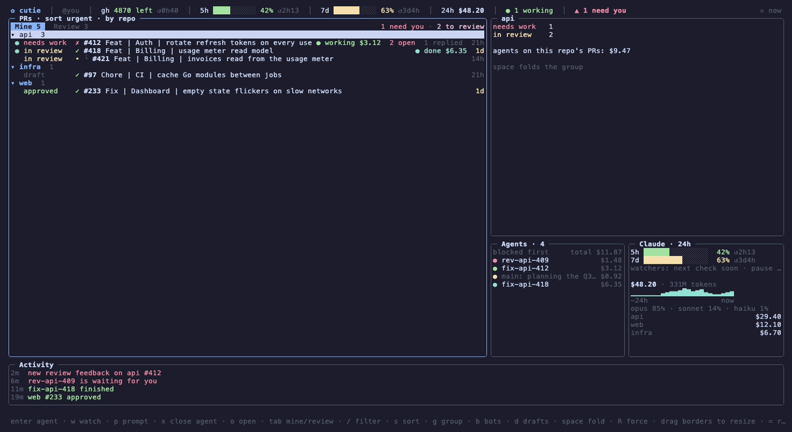

# cutie

[](https://github.com/rohansharmasitoula/cutie/actions/workflows/ci.yml)
[](https://pkg.go.dev/github.com/rohansharmasitoula/cutie)
[](go.mod)
[](LICENSE)
[](https://github.com/rohansharmasitoula/cutie/stargazers)
[](https://buymeacoffee.com/sitoularohansharma)

**A terminal dashboard for your pull requests and the AI coding agents working on them.**

cutie lists your open PRs and the PRs waiting for your review, tells you which ones need you, and with one key starts a coding agent on a PR in its own [herdr](https://herdr.dev) pane. It then shows what each agent is doing and what it has cost, and can watch PRs to wake the agent when reviewers reply or authors push.



## Features

| | |
|---|---|
| 📋 **One inbox for PRs** | Your open PRs and the ones waiting for your review, side by side in two tabs, grouped by repo. Stacked PRs nest under the PR they build on. |
| 🎯 **Only what needs you** | A PR is flagged when a reviewer is waiting on your reply or commented after your last push. Threads you've already answered stay quiet. |
| ⚡ **An agent in one keystroke** | Press `enter` on a PR: cutie opens the repo in herdr, starts a coding agent in its own tab and hands it the PR. Press it again to jump there. |
| 👀 **See every agent at work** | Each agent's status, cost and latest output, right beside the PR's checks, reviewers and open threads. |
| 🔔 **Watchers** | Watch a PR and its agent wakes up by itself when reviewers reply to yours, or when the author pushes to one you're reviewing. |
| 💸 **Claude usage, always visible** | Your 5 hour and 7 day limits with reset timers, 24h spend, tokens per hour and model split. Watchers pause before you run out. |
| 🪶 **Light on GitHub** | One tiny query a minute; full details only for PRs that changed, so your API budget lasts. |
| 🖱️ **Mouse or keyboard** | Click rows, drag borders to resize panels, filter, sort and fold repos. |

## Requirements

| Tool | Why | Required |
|---|---|---|
| [`gh`](https://cli.github.com), logged in | Reads your PRs | ✅ |
| [herdr](https://herdr.dev), server running | Workspaces, panes and agents | ✅ |
| A coding agent herdr supports (`omp`, `claude`, `codex`, …) | Works on the PRs | ✅ |
| [`omp`](https://github.com/can1357/oh-my-pi) | Claude usage panel and agent costs | Optional |

macOS and Linux. Go 1.24+ to build.

## Install

```sh
go install github.com/rohansharmasitoula/cutie@latest
```

Or from a clone:

```sh
git clone https://github.com/rohansharmasitoula/cutie
cd cutie
go build -o ~/.local/bin/cutie .
```

## Quick start

1. Keep your clones in one folder, each named after its repo, either directly (`~/Development/api`) or one folder down (`~/Development/acme/api`). Point cutie at it with `CUTIE_ROOT` if it isn't `~/Development`.
2. Start herdr in one terminal and `cutie` in another, or run cutie inside a herdr pane.
3. Press `enter` on a PR marked `needs work` or `to review`.

Try it without GitHub or herdr, on made-up data:

```sh
CUTIE_DEMO=1 cutie
```

## Configuration

| Variable | Default | Meaning |
|---|---|---|
| `CUTIE_ROOT` | `~/Development` | Folder holding your clones, directly or one folder down, named after the repo |
| `CUTIE_AGENT` | `omp` | herdr agent kind to start: `omp`, `claude`, `codex`, … |
| `CUTIE_INTERVAL` | `60` | Seconds between GitHub refreshes (minimum 10) |
| `CUTIE_WATCH_MINUTES` | `30` | Minutes between watcher checks |
| `CUTIE_GUARD` | `85` | Pause watchers when the Claude 5 hour window passes this percentage |
| `CUTIE_DEMO` | unset | `1` shows made-up data and calls nothing |

### Prompts

cutie sends an agent one of four messages. The built-in ones work with any agent: they ask it to read the PR with `gh`, fix or review it, commit locally, and **never push or post to GitHub**.

To use your own, put a file with the same name in `~/Library/Application Support/cutie/prompts/` (macOS) or `~/.config/cutie/prompts/` (Linux):

| File | Sent when |
|---|---|
| `fix-start.md` | Starting an agent on your PR |
| `fix-followup.md` | A watcher sees new review feedback on your PR |
| `review-start.md` | Starting an agent on someone else's PR |
| `review-followup.md` | A watcher sees new commits on a PR you review |

Prompts are Go templates with `{{.URL}}`, `{{.Repo}}`, `{{.Number}}`, `{{.Branch}}`, `{{.Base}}`, `{{.Author}}` and `{{.HeadShort}}`. For example, to hand the work to your own subagent:

```text
Spawn an `orchestrator` task agent to address the review feedback on {{.URL}} (branch {{.Branch}}). Commit locally; do not push.
```

The defaults are in [`internal/agents/prompts`](internal/agents/prompts).

## Keys

| Key | Action |
|---|---|
| `↑` `↓` / `j` `k` / wheel / click | Move (`pgup` `pgdn` `home` `end` too) |
| `enter` / click the selected row | Jump to the PR's agent, or start one. On a repo row: fold it |
| `p` | Send a prompt to the PR's agent |
| `x` `x` | Close the PR's agent pane (the first `x` asks) |
| `w` | Watch or unwatch the PR |
| `o` | Open the PR in the browser |
| `tab` / `1` / `2` | Mine / Review |
| `/` | Filter (`esc` clears) |
| `s` | Sort: urgent → updated → waiting |
| `g` | Group by repo on or off |
| `space` | Fold or unfold the repo |
| `b` / `d` | Hide or show bot PRs / drafts |
| `r` / `R` | Refresh / refresh and run the watchers now |
| drag a border / `=` | Resize panels / reset sizes |
| `?` | Help |
| `q` | Quit |

## How it works

### PR status

| Tab | Status | Meaning |
|---|---|---|
| Mine | `needs work` | A review thread waits on your reply, or a reviewer wrote after your last push |
| Mine | `in review` / `approved` / `draft` | As on GitHub |
| Review | `to review` | You haven't reviewed it |
| Review | `new commits` | The author pushed after your last review |
| Review | `reviewed` | You reviewed the current head |

A PR is drawn as stacked when the same author's PR branch is its base. Shared branches (`main`, `staging`, `development`, …) never count.

### Agents

For `owner/repo#N`, cutie uses the herdr workspace labelled `repo` (created in the repo's clone if missing), a tab labelled `fix #N` or `review #N`, and an agent named `fix-repo-N` or `rev-repo-N`. The name ties the agent to the PR, so cutie can show its state and jump back to it.

### Watchers

`w` remembers the PR's current state. Every `CUTIE_WATCH_MINUTES`, a watched PR with newer activity gets its agent woken with the follow-up prompt, or a new agent started. A watcher waits while its agent is working or waiting for you, and all watchers pause above `CUTIE_GUARD`. Watches end when the PR is merged or closed, and only run while cutie is open. The Activity panel logs every check.

herdr notifications fire when an agent starts waiting for you and when a watched PR of yours gets new feedback.

### Files

cutie keeps `watches.json`, `sizes.json` and `prompts/` in `~/Library/Application Support/cutie/` (macOS) or `~/.config/cutie/` (Linux).

## Project layout

```text
main.go                  entry point: config, prompts, state → ui.Run
internal/
  config/                CUTIE_* settings
  github/                PR queries through gh, status rules, rate limit
  herdr/                 workspaces, panes, agents, notifications
  omp/                   Claude plan windows, 24h stats, per-session cost
  agents/                agent names, watch triggers, prompt templates
  state/                 watches and panel sizes on disk
  ui/                    Bubble Tea model, views, demo data
  utils/                 running CLIs, formatting, text layout
docs/demo.tape           recording script for docs/demo.gif
```

## ☕ Support

If cutie saves you time, you can support its development:

[](https://buymeacoffee.com/sitoularohansharma)

## License

[MIT](LICENSE)
